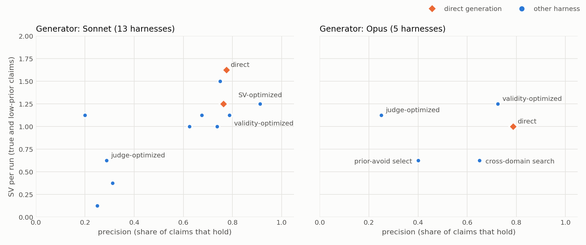

# ideation-goodhart

**What should you optimize when you optimize an LLM research-ideation harness?**
Pre-registered pilot experiments on two hypothesis spaces with measured ground truth (NAS-Bench-201; HPOBench tabular MLP hyperparameters).



This repository has two parts: **tools** you can use today, built on what the study found, and the **study** itself (pre-registrations, every LLM call, analysis scripts, report).

## Quick start: the tools

```bash
git clone https://github.com/shangliy/ideation-goodhart && cd ideation-goodhart && ./install.sh
ideagen demo --dry-run    # prints the prompt, no LLM calls
ideagen demo              # 3 LLM calls: direct generation vs measure-first, scored on held-out runs
```

Or install the pieces separately:

```bash
pip install git+https://github.com/shangliy/ideation-goodhart                                           # ideagen CLI
claude plugin marketplace add shangliy/ideation-goodhart && claude plugin install research-ideation@ideation-goodhart   # Claude Code skills
```

Inside Claude Code, the plugin installs in one step with `/plugin install research-ideation --marketplace shangliy/ideation-goodhart`.

**`ideagen`: hypotheses from measurements.** You give it an experiment grid. Before proposing, the model designs about 100 single-edit experiments and reads their noisy results; this is the arm that helped in the study. It then proposes conditional hypotheses ("setting *j* = *b* raises the metric more when *k* is at level *c*") and checks each one.

| You have | Command | How hypotheses are checked |
|---|---|---|
| a CSV of finished runs, one row per run | `ideagen table runs.csv --metric val_acc --group dataset` | the CSV is split in half; probes read one half, verdicts come from the other, next to the random base rate |
| a script: config JSON on stdin → metric on stdout | `ideagen run --space space.json --run-cmd "python train.py" --verify-n 8 --jobs 4` | probes are real runs; `--verify-n` re-tests each hypothesis with fresh paired runs (supported / contradicted / inconclusive at 2 SE) |

Other flags:
- `--describe "..."`: what the experiments are.
- `--mode direct|measure|both`.
- `--prior haiku,opus`: a blind rating panel; a supported hypothesis rated below 50 is a surprise.
- `--llm-cmd`: any CLI that reads a prompt on stdin, for example `"codex exec -"`, for non-Claude models.

See [examples/](examples/) for a space file and a toy training script. [examples/demo_output.md](examples/demo_output.md) is one real `ideagen demo` run with Sonnet:
- direct generation: 2 of 10 hypotheses supported on held-out runs;
- measure-first: 7 of 10;
- random guessing: 0.08.

This is one run on a synthetic grid, an illustration rather than a benchmark.

**`research-idea` skill (Claude Code): ideas from papers.** Say "find research ideas in these papers" or "/research-idea". The workflow runs in this order:
1. gap cards with evidence pointers;
2. cross-domain mechanism transfer;
3. a prior-art check before any ranking, including a system-level query for recent work;
4. reviewer verdicts;
5. proposals with a pre-registered decisive experiment and kill criteria.

Everything is kept in an idea ledger, so refuted ideas stay refuted. Following the findings below, it never ranks by an LLM's novelty score, and it hands off to `ideagen` when you have data.

## Summary

We ask an LLM to propose 10 testable conditional hypotheses about a benchmark whose data it cannot see:

> "Setting edge *j* to op *b* helps more (or less) when the parent cell has op *c* on edge *k*."

Every such claim, 1,740 in all, can be checked against the fully tabulated NAS-Bench-201 results; 198 of them hold. We also need to know which claims are surprising. Three models (Haiku, Sonnet, Opus) rate every claim, which gives a shared prior. A claim is **surprising-valid (SV)** if it holds and the models other than the generator rate it below 50%.

We then optimize the ideation **harness** with the same Harness²-style optimizer under three fitness functions. The harness covers retrieval, roles, self-challenge, selection, and free-text strategy. The three fitness functions are:

- **J**: an LLM judge's novelty + quality score;
- **V**: the number of hypotheses that hold;
- **SV**: the number of surprising-valid hypotheses.

## Findings (pilot scale; all criteria pre-registered)

| | Result | Verdict |
|---|---|---|
| **A. Judge fitness Goodharts** | The judge-optimized harness raises the judge score (Sonnet 7.5 → 8.2, p = .018; Opus 8.2 → 8.9, p < .001) while precision collapses (stage 5, 24 fresh runs per arm: Sonnet .79 → .43, Opus .87 → .28). Transferred unchanged to the HPOBench space (stage 9), the same harness again raises the judge score (+1.0, +1.8) and collapses precision (.82 → .43, .90 → .42); on a private transfer space .40 → .03. The optimizer learned to *ban* the claim types that are most often true, because the judge finds them obvious. The drop in surprising-valid claims replicates only partly: not on NB201 at larger n, but yes for Opus on HPOBench (4.17 → 2.46). | A-prec, A-judge supported in 2 spaces × 2 models; A-SV 1 of 3 tests |
| **Validity fitness plays safe** | The validity-optimized harness restricts itself to mechanical claim types. The mean prior rises by 6 points, the set of distinct claims narrows, and neither precision nor SV improves. | P2 supported |
| **SV fitness does not help** | No candidate beat direct generation. After a bug fix and a rerun, the one accepted candidate regressed on fresh runs from 1.67 to 1.25 (winner's curse). | P3 refuted |
| **M. Measurement pushes the frontier** | Before proposing, the model designs 100 experiments (one edit on one parent cell; measured on the test split, truth uses val) and reads the results. With Opus, SV doubles from 1.08 to 2.12 per run (24 fresh runs per arm, 90% CI [+0.54, +1.58], Holm p = .003) at .75 precision; the arm scored 2.12 in all three independent batches. With Sonnet, SV does not move (+0.04, CI upper bound +0.38) and precision collapses (.79 → .45), On HPOBench, where each measurement is a real single-seed training run (70% sign agreement with the 5-seed truth), both models gain: Sonnet 1.83 → 2.71 (Holm .002), Opus 4.17 → 4.67 (Holm .019), with no precision loss. | Supported in 3 of 4 model × space cells; fails for Sonnet on NB201 |
| **D. The frontier does not move** | 19 harnesses across two generators were tested on fresh runs, including a design-only harness (stage 8); none beats plain direct generation on SV after Holm correction (largest gain +0.25 per run). On Sonnet, lowering the prior costs precision (ρ = .87 across 13 harnesses); on Opus, the frontier shape is inconclusive (ρ = .40, 5 harnesses). | D1 supported, D2 inconclusive |

**Takeaway.**
- An LLM judge is an exploitable target for ideation optimization: it rewards moving away from the prior and pays for it in precision.
- Harness engineering that only changes the model's internal reasoning (retrieval, roles, challenge, selection, strategy text) trades precision against surprise along a frontier; it does not push the frontier.
- Letting the model design and read 100 cheap, even noisy, experiments before proposing increases true-and-surprising findings in 3 of 4 model × space cells; designing experiments without results does not. The one failure (Sonnet on NB201, a space it knows well) is a precision collapse.

The full report is in Chinese: [REPORT.md](REPORT.md). It covers background, related work, every stage, verdicts, limitations, and cost.

## Repository layout

```
ideagen/                        the ideagen CLI (space.py claims and held-out truth, generate.py prompts, runner.py your own command, demo.py synthetic grid)
plugin/                         Claude Code plugin: skills/research-idea, skills/ideagen
.claude-plugin/marketplace.json marketplace entry for the plugin
examples/, tests/               space file and toy training script; offline tests with a fake LLM (python3 -m unittest discover tests)
REPORT.md                       full experiment report (Chinese)
figures/                        frontier.png and the script that draws it
experiments/harness/
  nb_space.py, nb_space.json    NB201 claim space (870 cells x 3 datasets, derived from NAS-Bench-201)
  search.py                     literature retrieval with a blocklist for papers that analyse the benchmark table
  s1.py, s1_analyze.py          stage 1: L9 screen of structural knobs (retrieval, roles, challenge, selection)
  s2.py, s2_analyze.py          stage 2: one optimizer, three fitness functions; stage 3: fixed SV arm, Opus generator
  s3_analyze.py                 stage 3: frontier test (claim D)
  s4.py                         stage 4: measurement knob (random / actively designed probes before proposing)
  s5.py                         stage 5: 24-run confirmation of A and M for both generators
  s6.py                         stage 6: M under noisy and low-fidelity measurements (Opus)
  s7.py                         stage 7: shuffled-results and design-only controls (Opus)
  s8.py                         stage 8: design-only harness, no results (Opus, Sonnet)
  fc_space.py, fc_space.json    second space: HPOBench tabular MLP claim space (derived statistics)
  s9.py                         stage 9: BASE / judge harness / measurement on the second space
  PREREG_s*.md, RESULT_s*.md    pre-registrations (written before any call) and results, in Chinese
  out/, out2/                   every LLM call, cached by content (prompts' outputs, priors, judge scores, optimizer logs)
```

## Reproduce

```bash
pip install -r requirements.txt
cd experiments/harness
python3 s1_analyze.py && python3 s2_analyze.py && python3 s3_analyze.py && python3 s4.py analyze && python3 s5.py analyze && python3 s6.py analyze && python3 s7.py analyze && python3 s8.py analyze && python3 s9.py analyze   # no API calls, reads the caches
python3 ../../figures/make_frontier.py
```

Producing new runs needs the `claude` CLI. Every role is one `claude -p --tools ""` call. Uncached literature queries also need a retriever (`LITSEARCH`, a script that prints arXiv/OpenAlex/Semantic Scholar hits). Rebuilding `nb_space.json` needs a NAS-Bench-201 table loader (`NB201_LOADER`).

## Scope and caveats

- **Harness training on one space.** Harnesses were optimized only on NB201, which the models know well (direct generation reaches .78 precision). The second space (HPOBench, stage 9) tests direct generation, the transferred judge harness and measurement only. The private CTR transfer space used in the original study is not released, so only aggregate numbers are reported.
- **Small optimization and evaluation budgets.** Each arm ran 3 rounds × 3 candidates × 6 runs. Most harnesses got 8 fresh runs, and only the three key arms got 24 in stage 5. Two batches of 8 runs of the same harness can differ by up to 1 SV per run.
- **What drives the measurement gain.** With Opus, the SV gain survived synthetic seed-level noise (N1, assumed σ), doubled noise (N2) and 12-epoch proxy values (L); only precision degraded. Shuffling the results across probes dropped SV to 1.42 and precision to .58 (clean minus shuffled +0.71, Holm .072, inconclusive). Showing the probes designed for measurement without results gave 1.83, but a true design-only harness (the model knows no results will come) gave 1.25 for Opus and 1.21 for Sonnet, no better than direct generation. Measurement helps Opus; its quality mostly affects precision; the independent contribution of the values has not yet passed the pre-registered bar.
- **Claude-only model panel.** The judge and proposer are both Opus, and the prior panel contains only Claude models.
- **A regex bug**, now fixed, rejected 3 candidates in stage 2. See REPORT.md §5.4.
- **Claim D was formed after stage 2.** Its test (stage 3) was pre-registered.

## Related work

Si et al. 2601.14525 (execution-grounded ideation rewards; safe-idea collapse), HindSight 2603.15164 (judge scores vs later impact), Gao et al. 2210.10760 (reward-model overoptimization), IdeaScientist 2610.04074, Harness² 2610.14224, ADAS 2408.08435, AFlow 2410.10762, NAS-Bench-201 (Dong & Yang, ICLR 2020).

## License

MIT for the code. `nb_space.json` and `fc_space.json` contain summary statistics derived from NAS-Bench-201 and HPOBench (figshare file 30379005); see those benchmarks' own terms. Running new stage-9 measurements needs the HPOBench `nn` table (`FC_TAB`, extracted with per-seed val/test accuracy).
